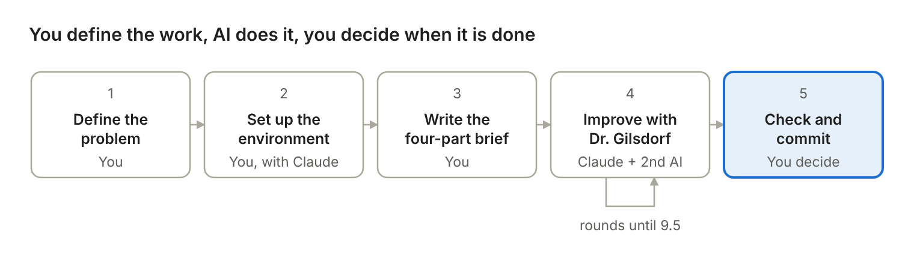

# The Panaversity AI Method

The **Panaversity AI Method** is the way Panaversity's own team works with AI, and the way you work through every step of this bootcamp. The book describes it in [How the Panaversity team works](https://agentfactory.panaversity.org/claude-and-chatgpt-2/new-way-of-working/how-the-panaversity-team-works/#what-is-the-panaversity-ai-method). This page shows where each of its five steps happens here.

<picture>
  <source media="(prefers-color-scheme: dark)" srcset="../assets/panaversity-ai-method-dark.png">
  
</picture>

One idea sits under all five steps: **AI does most of the work, and a person decides what the work is for and when it is done.** In this bootcamp, that person is you.

## The five steps in this bootcamp

| Step | What it means | Where you do it here |
| --- | --- | --- |
| **1. Understand and define the problem** | Decide what you want, why it matters and how you will know it is done. | Before you start a step, read Copperleaf's ask, **What you will make** and the **Submission checklist**: they are the problem and the "done" test. In the step 24 capstone, you define the problem yourself, from your own role. |
| **2. Set up the environment** | A safe place for the work that keeps every version, with Claude given only the access it needs. | Once, in [Step 00](../step-00-readiness-check/README.md), Part A, and [How we work](../README.md#how-we-work-local-first-human-in-the-loop) items 1 to 3: your fork, your local clone, a Claude project with the folder and the fork, and "never commit or push" in its instructions. Then a new thread for each step. |
| **3. Write the four-part brief** | Outcome, context, format and constraints, with the checks the work must pass. | Until step 12, each step's prompts under **Do it with Claude** are briefs written for you: read each one before you paste it, so you know what "done" means. From step 13 you change them to fit (each step's 🧭 note says how far), in [step 17](../step-17-four-part-brief/README.md) you learn the four parts, from step 21 you write them, and in the capstone you write one for a task from your own role. |
| **4. Improve the work with the Dr. Gilsdorf method** | Grade and improve the work in rounds toward 9.5 out of 10, run the checks, and get an independent review from a second AI. | You try it in [step 2](../step-02-three-deliverables/README.md) and do it in full in [step 4](../step-04-second-opinion/README.md). After that, use the prompt below on anything you write. The step's **Check it** section and checklist are the pass-or-fail checks. |
| **5. Check and commit** | A person checks the final result, approves it and saves it as the official version. | Each step's **Check it** and **Keep it** sections: check the facts against Copperleaf's files, open any Word or slide file the job made, read the changes in GitHub Desktop, then commit, tag `step-NN-done` and push them yourself, and submit as [SUBMITTING.md](../SUBMITTING.md) says. |

## Rules that never change

- **Claude never commits or pushes.** You read every change in GitHub Desktop and commit it yourself. That is the human in the loop.
- **Claude asks before it acts.** Let it do routine work in the step's `work/` folder, and approve anything that sends, deletes or cannot be undone yourself.
- **Checks outrank grades.** A grade is an opinion. A wrong figure fails the work, whatever the grade says, so you check the facts yourself.
- **Share only what is allowed.** Copperleaf's data is made up, so you may give it to a second AI. With real work, send another AI only what your company's rules allow.
- **Your work stays in your fork.** Never open a pull request to the bootcamp repo.

## A prompt for anything you write

Paste this into the step's thread when a deliverable is ready, before you commit it:

```text
Before I keep this, check every figure and fact in it against Copperleaf's files and list any that don't match. Then grade it out of 10 in three areas: accuracy, quality, and how easy it is for the reader to understand. Give the evidence for each grade. A wrong figure counts for more than any grade. Improve it in small rounds until every check passes and each area reaches 9.5, for at most three rounds, and then list anything still open. Never commit or push.
```

Then give the work and its sources to a second AI, such as ChatGPT, and ask it to review and grade the same three areas, with specific fixes and evidence. Don't show it Claude's grades. Paste its review back into the thread and ask Claude to weigh each point, fix what is right, and check the facts again.

## References

From [The AI Agent Factory](https://agentfactory.panaversity.org/), the book this bootcamp accompanies:

- [How the Panaversity team works](https://agentfactory.panaversity.org/claude-and-chatgpt-2/new-way-of-working/how-the-panaversity-team-works/): the full description of the method, with its diagrams.
  - ["What is the Panaversity AI Method?"](https://agentfactory.panaversity.org/claude-and-chatgpt-2/new-way-of-working/how-the-panaversity-team-works/#what-is-the-panaversity-ai-method): the five steps and when to use each.
  - ["Where does the work live?"](https://agentfactory.panaversity.org/claude-and-chatgpt-2/new-way-of-working/how-the-panaversity-team-works/#where-does-the-work-live): the repository, the Claude project and committing by hand.
  - ["How do we improve the work?"](https://agentfactory.panaversity.org/claude-and-chatgpt-2/new-way-of-working/how-the-panaversity-team-works/#how-do-we-improve-the-work): the Dr. Gilsdorf method, step by step.
- [Appendix: versions and pull requests](https://agentfactory.panaversity.org/appendices/claude-and-chatgpt-2/appendix-versions-and-pull-requests/): why a person reads every change before it is kept.

---

[Back to the bootcamp README](../README.md#how-we-work-local-first-human-in-the-loop)
